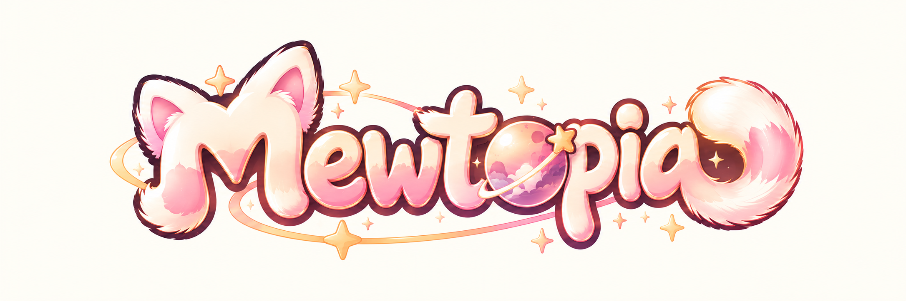

  
  <h2>喵托邦 · 一座由貓咪與創意組成的小宇宙</h2>
  
獨立小遊戲 × 原創角色 × 貓咪內容

  
<strong>Small games, big purrs.</strong>

---

## 關於 Mewtopia

**Mewtopia（喵托邦）** 是以貓咪為靈感的小型創作工作室。我們希望用輕巧、好玩、能隨時開心玩上一局的小遊戲，慢慢建立自己的角色與故事。

目前從 **Cocos Creator + TypeScript** 的輕量遊戲出發，未來也會探索貓咪短影片與原創角色內容。

## 正在準備的作品

| 方向 | 計畫 | 進度 |
| --- | --- | --- |
| 🎮 首款小遊戲 | **《貓貓下樓梯》**：輕量貓咪小遊戲（暫定名稱） | 操作原型 |
| 🧩 共用框架 | **CatGameFramework**：遊戲狀態、事件與核心工具 | v0.1 骨架 |
| 🐾 貓咪宇宙 | 貓咪角色、短影片與原創 IP | 構想中 |

## 我們的開發方式

- **先好玩，再精緻：** 做出最小操作原型，驗證玩法，再打磨視覺。
- **小遊戲，共用底座：** 遊戲與通用框架分離。
- **溫柔的美術語言：** 粉金漸層、卡通、蓬鬆柔軟的貓咪。
- **工程透明有序：** Issue、Pull Request、測試與階段性驗收。

## 聯繫與合作

仍在第一款作品的初期建置階段。私人 Repository 不代表作品已正式發行。

> 品牌名稱及商標仍須正式查核；本頁不表示商標已獲核准。
